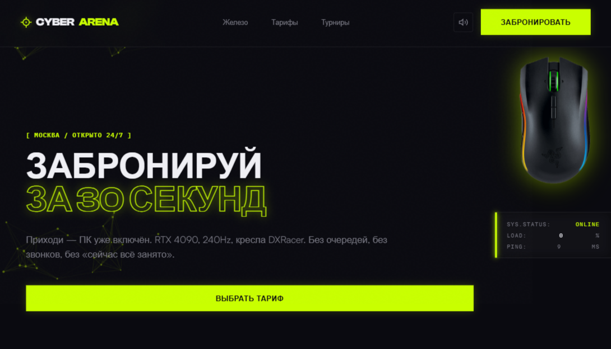

# CYBER ARENA

> Забронируй ПК за 30 секунд. Приходи — ПК уже включён.

Интерактивный лендинг киберспортивного клуба на Vanilla JS + Vite.

## ✨ Что внутри

- Boot screen (терминал)
- Кастомный курсор-прицел
- Мышка-компаньон (параллакс + 3 роли по скроллу)
- Звук (Web Audio API) + mute
- Модалка бронирования (15 ПК)
- Canvas-частицы
- prefers-reduced-motion
- Адаптив

## 🛠 Стек

- Vite
- Vanilla JS (ES-модули)
- GSAP + ScrollTrigger
- Canvas 2D
- Web Audio API
- CSS (Grid, backdrop-filter, clamp)

## 🎨 Палитра

| Параметр | Значение            |
| -------- | ------------------- |
| Фон      | #0A0A10             |
| Текст    | #F0F0F5             |
| Muted    | #7A7A85             |
| Акцент 1 | #C9FF00 (acid lime) |
| Акцент 2 | #FF3D00 (ember red) |

## 🚀 Запуск

npm install
npm run dev

## 📦 Сборка

npm run build

## 🌐 Деплой

GitHub Actions → GitHub Pages при пуше в main.

## 📁 Структура

neon-arena/
├── public/
│ ├── mouse.png
│ └── og-image.jpg
├── src/
│ ├── main.js
│ └── style.css
├── index.html
└── package.json

## 🎯 Философия

Не "красивый сайт", а "продающий лендинг":

1. Каждая спека — польза
2. Каждый тариф — для кого-то
3. Каждый CTA — конкретное действие

## 📄 Лицензия

MIT

## 👤 Автор

**alphastatex** — https://github.com/alphastatex
